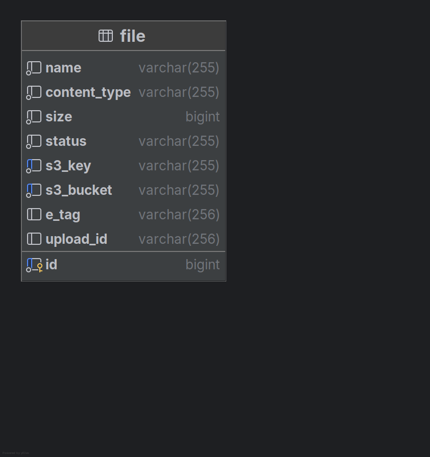
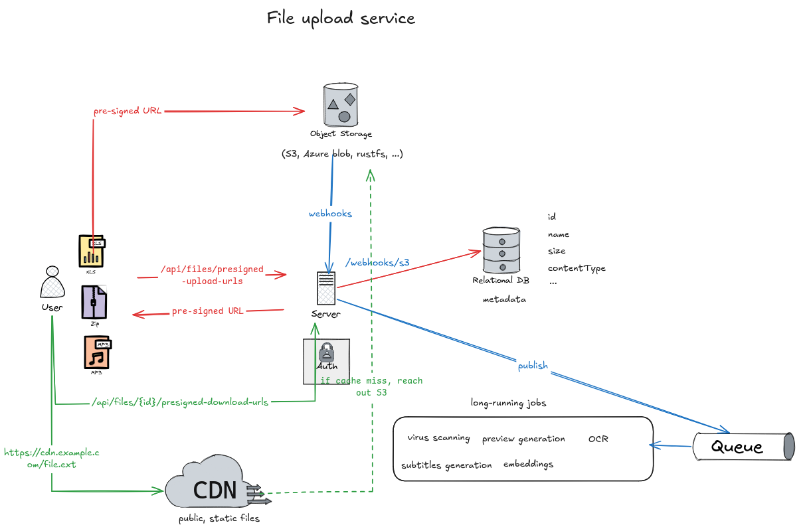

# File Upload Service

I'm learning system design by doing. File upload is a key service in any modern app. The system design for the file
upload service was inspired by [Milan Jovanović](https://www.youtube.com/watch?v=ka_WCmNdybE), the following is an
implementation using Spring boot 4 and Next.js 16.

Check out the [File Upload Client](https://github.com/WissemBoujlida/file-upload-client).

## Functional Requirements

What the system must do:

1. upload / download files
2. store file metadata
3. async processing of files

## Non-Functional Requirements

Qualities the system must have:

1. work with large files
2. security (upload/download)

## Core Entities

## API

### Download

GET /files/{fileId}/presigned-download-urls

### Single PUT upload

POST /files/presigned-upload-urls

### Multipart upload

POST /multipart-uploads `start multipart upload`

POST /multipart-uploads/{uploadId}/presigned-upload-urls `generate presigned part upload URL`

POST /multipart-uploads/{uploadId}/complete

POST /multipart-uploads/{uploadId}/cancel

### S3 webhook

POST /webhooks/s3

## Data Flow

upload / download files directly from object store using pre-signed URLs.

### Upload File

1. client requests a presigned upload URL
2. server authenticates & authorizes client
3. server stores file metadata
4. server generates presigned upload URL
5. client uploads file directly to object store using presigned upload URL.
6. object store notifies server when file upload is complete using webhooks.
7. server publishes a "file ready" event to message broker.
8. subscribers consumes "file ready" event to start long-running background jobs: (eg: virus scanning, OCR,
   embeddings, ...)

### Download File

1. client requests a presigned download URL
2. server authenticates & authorizes client
3. server generates presigned download URL
4. client downloads file directly from object store using presigned download URL.

public static files are served using a CDN (Content Delivery Network).

## High Level Design

### Object Store

The object store is the center component for the file upload service allowing us to:

- work with large files
- use multipart upload (break down a large file into smaller chunks and stream those chunks to the object store)
- pause / resume upload
- configure file deduplication + retention policies

I'm using rustfs (an open source (Apache 2.0) AWS S3-compatible object storage built in rust, self-hosted on a cheap VPS
to spice things up a bit)

### Message Broker

I'm using Kafka (confluent).

When file upload is complete, S3 notifies the server using webhooks, the webhook client publishes "file ready" event to
the "
file" topic. 
consumers (subscribers) listen to the "file" topic". 
for each job (preview generation, OCR, embedding...) we define a new consumer group 
consumers in a consumer group (specific job) are competing workers for that specific job (message queue pattern). 

### CDN

a CDN is globally distributed network of servers that route (forward) client requests to geographically closest
edge. 

I'm using cloudflare (Free plan)

### Metadata

I'm using PostgreSQL to store file metadata.

file metadata are persisted each time the client requests a presigned upload URL, file status is set to UPLOADING and
later updated when file upload is complete.

## Deep Dives

### signle-put VS multipart upload

if file size `< 20 MB`: single presigned upload 
if file size `>= 20 MB` switch to multipart upload: `PART_SIZE=10MB` 

### Signature duration

pre-signed URLs are bearer tokens, anyone who intercepts pre-signed URLs can upload or overwrite data within that
window. 
if you set the signature duration to be 5 Minutes, then the client has 5 minutes to start the upload/download; an
upload/download that starts at minute 4 and takes 35 minutes to stream will still succeed 

### eTag (entity tag)

for single-put upload, eTag = MD5 hash 
for multipart upload, eTag = MD5 hash(concat(eTags of uploaded parts))-part_count 
use eTags for caching (browser, CDN) or integrity checks. 

### CDN Cache Invalidation

1. user put/delete file
2. old file is marked as PENDING_DELETE
3. @Scheduled job: 
   3.1 delete files marked as PENDING_DELETE from S3 
   3.2 mark files as PENDING_CACHE_PURGE 
4. @Scheduled job:
   4.1 purge cached files marked as PENDING_CACHE_PURGE
   4.2 mark files as DELETED

#### file PUT

every file upload uses # UUID → # URL → users sees new file immediately. 
use TTL or let Cloudflare use LRU eviction

#### file DELETE

Cloudflare's Purge Cache API (Free Plan Rate Limit: 5 RPM, 100 URLs PR)
purge cache using a @Scheduled job